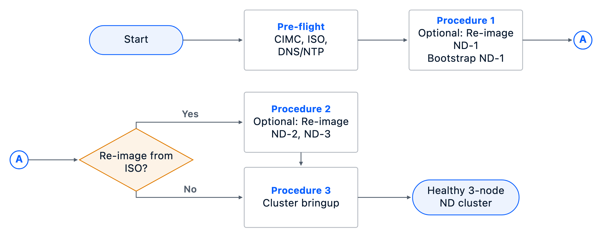

# Subsystem 01 - Nexus Dashboard 4.2.x cluster install

Deploy a 3-node Cisco Nexus Dashboard 4.2.x cluster (validated against 4.2.1.10) on dedicated UCS C-Series appliances. The cluster is the management plane for the AI POD frontend and backend fabrics (Sections 02 and 03).

## Reference

[Cisco AI POD for Enterprise Training and Fine-Tuning with Everpure Deployment Guide](https://www.cisco.com/c/en/us/td/docs/unified_computing/ucs/UCS_CVDs/cisco_aipod_pure.html) - chapter "Deploy Cisco Nexus Dashboard". The reference CVD uses ND 4.1.x; this section adapts the procedure to ND 4.2.x and notes any version-specific deltas inline.

## Outcome

A healthy 3-node ND cluster on the operator's mgmt + data subnets, with DNS, NTP, and a persistent IP pool configured, ready to host the NDFC service for fabric management.

## Prerequisites

This is the customer-facing summary for scoping a deployment. The verbose,
operator-executable form (with validation commands and per-step screenshots)
lives in [`docs/MOP-ND4-install.md` § Assumptions and Prerequisites](docs/MOP-ND4-install.md#assumptions-and-prerequisites);
the automation-runnable form is [`automation/scripts/precheck.py`](automation/scripts/precheck.py)
([`docs/precheck-checklist.md`](automation/docs/precheck-checklist.md)).

### Hardware

- **Three ND appliances cabled and powered, CIMC reachable from your workstation.** Mgmt + data NICs cabled to their respective switches per the per-node table in [`docs/MOP-ND4-install.md` § Setup Information — Table 2](docs/MOP-ND4-install.md#setup-information).

### Software

- **Nexus Dashboard ISO hosted on an HTTP server reachable from every node's CIMC.** ISOs are ~11.6 GiB and pulled fresh per node via CIMC vMedia; HTTP server and CIMC management-link bandwidth directly dominate per-node install time (~20–30 min on a healthy ≥1 Gbps lab path; multi-hour on slow or WAN-routed paths). Host the ISO on the same lab segment as the CIMCs whenever possible. (Cisco's [ND 4.2.x physical-appliance deployment chapter](https://www.cisco.com/c/en/us/td/docs/dcn/nd/4x/deployment/42x/cisco-nexus-dashboard-deployment-guide-42x/m-deploying-as-a-physical-appliance.html) covers the CIMC vMedia mount procedure step-by-step.)
- **All three nodes on the same ND OS release as the inventory-selected ISO before cluster formation.** Inventory `nd_cluster_spec.start_mode` selects the path:
    1. **`iso_reimage`** (this lab): install that ISO on ND-1, ND-2, and ND-3 before cluster formation.
    2. **`factory_preinstalled`**: positively verify the selected release on all three nodes and skip imaging.
  Pre-validation: [`scripts/precheck.py --category version`](automation/docs/precheck-checklist.md). For `factory_preinstalled`, an unverified node is a FAIL.

### Network

- **L3 reachability from ND-MGMT (the leader's `bond1` interface) to every node's CIMC over TCP/22 and TCP/443.** This is non-optional and is documented as a hard requirement in the [Cisco ND 4.2.x Deployment Guide § Prerequisites and Guidelines](https://www.cisco.com/c/en/us/td/docs/dcn/nd/4x/deployment/42x/cisco-nexus-dashboard-deployment-guide-42x/m-prerequisites.html) — *"the management network must provide IP reachability to each node's CIMC using TCP ports 22 and 443 as the Nexus Dashboard cluster configuration uses each node's CIMC IP address to configure the node."* If CIMCs sit in a different VLAN, VRF, or behind a firewall, validate the path with a 5-row ping matrix (mgmt gw + data gw + 3 CIMCs) from inside ND-1 *before* committing — recipe in [MOP § Assumptions and Prerequisites — "Out-of-band CIMC access"](docs/MOP-ND4-install.md#assumptions-and-prerequisites). Preferred placement: CIMCs on a segment that routes to ND-MGMT through a pre-permitted lab firewall ([decision D-011](CHANGELOG.md#d-011--cimcs-live-on-the-lab-oob-mgmt-vlan-to-keep-cluster-commit-pre-flight-on-a-single-lab-vrf-path)); fallback is an explicit static route ([D-008](CHANGELOG.md#d-008--when-cimcs-live-on-the-data-subnet-the-lab-must-route-mgmt-vlan--data-vlan), [troubleshooting §14 + §16](automation/docs/troubleshooting.md#14-cluster-commit-fails-because-mgmt-vlan-cant-route-to-cimcs-on-another-vlan)).
- **DNS servers must resolve every NTP hostname you list.** ND's `verifyremoteservices` does the lookups from inside the cluster; one failed name returns HTTP 500 for the entire verify. If your DNS doesn't cover the NTP names, switch to NTP IP literals ([troubleshooting §2](automation/docs/troubleshooting.md#2-verifyremoteservices-fails-on-ntp-dns-resolution)).
- **Data-plane access ports set to `spanning-tree port type edge`** (not `network`). ND VICs are end-stations and do not send BPDUs; a `network` neighbor leaves the link in Bridge Assurance Inconsistent (`BA_Inc`) state and silently blocks data with no operational signal until you check `sh spanning-tree` ([troubleshooting §3](automation/docs/troubleshooting.md#3-stp-bridge-assurance-blocks-the-data-vlan)).
- **Persistent IP pool — at least 5 IPs in the ND-DATA subnet, L2 mode**, with no collisions against node data or mgmt IPs. ND assigns these to services (NDFC, MSO, etc.) as services come online.

### Credentials

- **Treat the CIMC `admin` password and the ND cluster `admin` password as two independent credentials.** They have different blast radii (per-chassis hardware vs. cluster-wide login). Use distinct values in production; even in a lab where they happen to share a value, keep them in distinct slots in your secret manager so a future rotation doesn't conflate them. (Convention spelled out in [MOP § Credentials](docs/MOP-ND4-install.md#credentials-must-be-treated-as-distinct); secrets come from macOS Keychain in the lab and Vault in production — never inline.)

### Validation tooling

- **Run the pre-validation checklist before you start.** `python automation/scripts/precheck.py` catches ~30 common misconfigurations across categories `inventory`, `secrets`, `network`, `iso`, `dns`, `topology`, `version`, and `config` in ~30 s — far cheaper than discovering them mid-install. Switch-side checks (STP `port type edge`, MTU, LLDP, gateway reachability) are in §B of [`docs/precheck-checklist.md`](automation/docs/precheck-checklist.md); the operator-side workstation hygiene (caffeinate, stable VPN) is §C.

### Further reading

The prerequisites above are the deployment-blocking subset specific to this CVD; for the full, release-independent set of Cisco ND install, deploy, and upgrade documentation (covering every supported form factor, every release, and every cluster topology), see the [Cisco Nexus Dashboard Install and Upgrade Guides landing page](https://www.cisco.com/c/en/us/support/data-center-analytics/nexus-dashboard/products-installation-guides-list.html). Always cross-check the release notes for your specific minor before a production install.

For recovery from a stuck cluster bootstrap, see [`automation/docs/troubleshooting.md`](automation/docs/troubleshooting.md). The operator's primary recovery primitive is **`acs reboot factory-reset`** on a node — it clears bootstrap state in ~5 min without an OS reinstall (does **not** reconcile OS-version drift; see the upgrade prerequisite above).

For the running list of changes to this section's MOP, scripts, and docs (with the rationale for each), see [`CHANGELOG.md`](CHANGELOG.md).

## Two paths

You can do this section either way; both produce the same outcome.

| Path | When to use | Where |
|---|---|---|
| **Manual** | First time, learning, change-controlled environments | [`docs/MOP-ND4-install.md`](docs/MOP-ND4-install.md) |
| **Automation** | Repeated deployments, labs, CI | [`automation/`](automation/) |

For the screenshots embedded in the customer-facing chapter, the
universal [Playwright capture harness](../../docs/capture/README.md) under
`docs/capture/` covers the browser-reachable surfaces (CIMC
web UI, the ND cluster bringup wizard, steady-state ND views, and the
post-install landing pages); see the capture README for run modes and
the manual-capture guidance for vKVM/SOL/CLI surfaces it doesn't reach.

## Workflow

The chapter figures are SVG/PNG generated from
[`docs/workflows/scripts/build_workflow_figures.py`](docs/workflows/scripts/build_workflow_figures.py)
and embedded in the MOP at
[`docs/MOP-ND4-install.md` § Deployment Workflow](docs/MOP-ND4-install.md#deployment-workflow).
Figure 1 starts and ends with compact stadium ovals; procedure figures end on a rectangular Verify terminal.
The retired mermaid source is in [`docs/workflows/OLD/`](docs/workflows/OLD/).

