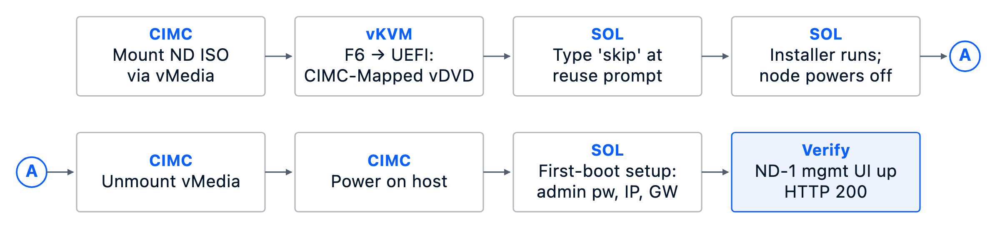
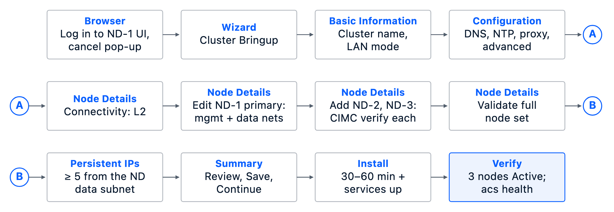

# Deploy Cisco Nexus Dashboard

The procedures in this chapter deploy a 3-node Cisco Nexus Dashboard (ND) cluster on Cisco UCS C-Series rack servers serving as physical ND nodes. The ND cluster manages and provisions all fabrics in the Cisco AI POD solution. Fabric onboarding is covered in later chapters.

The procedures will:

- Re-image all nodes using the specified ISO, or assume the correct image is present on all nodes.
- Bootstrap the first ND node using out-of-band CIMC management.
- Configure the remaining nodes and bring up a 3-node ND cluster from the first node's Cluster Bringup workflow.

## Assumptions and Prerequisites

Before implementing the procedures in this chapter, verify that the following prerequisites are met:

- Each node's CIMC has a configured, reachable IP address and valid administrator credentials.
- Switch ports, VLANs, MTU, routing, and gateway reachability for CIMC, ND-MGMT, and ND-DATA are in place. ND-MGMT must reach each CIMC over TCP 22 and TCP 443.
- The Nexus Dashboard ISO is hosted on an HTTP or NFS server reachable from every CIMC, and its SHA-512 matches the digest published on cisco.com.
- All three nodes on the same ND release (per the HW&SW compatibility matrix in [Table X]{custom-style="Highlight"}) before cluster formation.
- DNS and NTP services available for use by the Nexus Dashboard cluster.
- Persistent IP pool of at least 5 addresses on the ND-DATA subnet (L2 mode).
- Cisco Intersight account and licenses. DNS used by ND-MGMT must resolve `svc.intersight.com`. The Device Connector path must reach `svc.intersight.com` on TCP 443.
- If Cisco Cloud Control integration is used, configure the Intersight tenant in Cisco Cloud Control for unified, AI-driven operations, including single sign-on and consolidated inventory. Ensure the claiming user has the required permissions.

## Setup Information

Use the setup information in this section to complete the procedures outlined below. The procedures in this chapter are for manual deployment and use only the **Value** column.

::: {custom-style="Note"}
The Variable and Value columns match the key-value pairs used by automation. Ignore the Variable column for manual deployment.
:::

### Credentials

**Table 1. Credentials**

::: {colwidths="24,28,16,32"}


| Description               | Variable                                                                        | Value          | Notes                                                              |
| ------------------------- | ------------------------------------------------------------------------------- | -------------- | ------------------------------------------------------------------ |
| ND cluster admin username | `nd_admin_username`                                                             | `admin`        | Cluster UI, API, and CLI.                                          |
| ND cluster admin password | `vault_nd_admin_password`                                                       | `<user_input>` | Specified at first-boot of ND-1.                                   |
| CIMC admin username       | `nd_node.cimc.user`                                                             | `admin`        | Assumes same user for all nodes.                                   |
| CIMC admin password       | `vault_nd1_cimc_password`, `vault_nd2_cimc_password`, `vault_nd3_cimc_password` | `<user_input>` | 3-node cluster, one key per node. Same for Redfish, vKVM, and SOL. |


:::

### Cluster-wide parameters

**Table 2. Cluster-wide setup parameters**

::: {colwidths="21,23,20,36"}


| Description              | Variable                              | Value                                                               | Notes                                                                                                                                              |
| ------------------------ | ------------------------------------- | ------------------------------------------------------------------- | -------------------------------------------------------------------------------------------------------------------------------------------------- |
| Domain name              | `aipod.domain_name`                   | `aipod.local`                                                       | Shared site domain across AI POD solution.                                                                                                         |
| DNS search domain        | `aipod.dns_search_domains`            | `aipod.local`                                                       | Configured under Additional settings.                                                                                                              |
| DNS servers              | `aipod.dns_servers`                   | `192.0.2.53`, `192.0.2.54`                                        | Shared DNS servers across AI POD solution.                                                                                                         |
| NTP servers              | `aipod.ntp_servers`                   | `198.51.100.124`, `198.51.100.125`                                    | Shared NTP servers across AI POD solution. Preferred server: `198.51.100.124` (`aipod.ntp_preferred_server`).                                      |
| Timezone                 | `aipod.timezone`                      | `America/New_York`                                                  | Shared intent. Manual user-display preference in ND web UI; native ND setup does not apply a cluster-wide timezone or standalone host domain.       |
| Cluster spec             | `nd_cluster_spec`                     | NA                                                                  | Required for automation; ignore for manual. Parent structure for the relative variable keys below; for example, `.name` is `nd_cluster_spec.name`. |
| Start mode               | `.start_mode`                         | `iso_reimage`                                                       | Required for automation; ignore for manual. Re-image all nodes using the selected ISO, or none when all nodes are running the correct release.     |
| ISO URL                  | `.iso.url`                            | `http://192.0.2.150/software/Nexus-Dashboard/nd-dk9.4.3.1.175.iso` | Required when re-imaging (Procedures 1–2). Hosted image reachable from each CIMC.                                                                  |
| ISO SHA-512              | `.iso.sha512`                         | `5349fefdc4b601ea5fcc8ff7bdbbd40229c89c1fd31edaa6e8669b91daa984d0fd49061e9102d8c035a44288f410d23810cc4889d0cf1f3ad37f3ccb502a6a32` | Published SHA-512 digest for `nd-dk9.4.3.1.175.iso` on cisco.com.                                                                                 |
| Cluster name             | `.name`                               | `AIPOD-ND-CLUSTER`                                                  | Wizard default (Procedure 3).                                                                                                                      |
| Implementation type      | `.implementation_type`                | `LAN`                                                               | Wizard default.                                                                                                                                    |
| Management subnet        | `.network.mgmt_subnet`                | `192.0.2.0/24`                                                     | ND-MGMT                                                                                                                                            |
| Management gateway       | `.network.mgmt_gateway`               | `192.0.2.254`                                                      |                                                                                                                                                    |
| Data subnet              | `.network.data_subnet`                | `198.18.0.0/24`                                                     | ND-DATA                                                                                                                                            |
| Data gateway             | `.network.data_gateway`               | `198.18.0.254`                                                      |                                                                                                                                                    |
| CIMC subnet              | `.network.oob_subnet`                 | `198.51.100.0/24`                                                    | ND-CIMC                                                                                                                                            |
| App Network              | `.internal_networks.app_network`      | `172.17.0.1/16`                                                     | Cisco ND 4.3.x default. Must be `/16` and must not overlap any network the cluster needs to reach.                                                 |
| Service Network          | `.internal_networks.service_network`  | `100.80.0.0/16`                                                     | Cisco ND 4.3.x default. Must be `/16` and must not overlap any network the cluster needs to reach.                                                 |
| Proxy                    | `.proxy.skip`                         | `true`                                                              | Wizard: Skip.                                                                                                                                      |
| Persistent IP pool (≥ 5) | `.external_services.data_service_ips` | `198.18.0.20`–`198.18.0.24`                                         | ND-DATA. Minimum of 5.                                                                                                                             |


:::

### Per-node parameters

All three nodes are **Type = Primary**. Gateways and masks match the cluster-wide setup parameters.

**Table 3. Per-node setup parameters**

::: {colwidths="16,19,15,15,15,20"}


| Description   | Variable           | ND-1           | ND-2           | ND-3           | Notes |
| ------------- | ------------------ | -------------- | -------------- | -------------- | ----- |
| Hostname      | `nd_node.hostname` | `ND-1`         | `ND-2`         | `ND-3`         |       |
| CIMC IP       | `nd_node.cimc.ip`  | `198.51.100.87` | `198.51.100.88` | `198.51.100.89` |       |
| Management IP | `nd_node.mgmt.ip`  | `192.0.2.7`   | `192.0.2.8`   | `192.0.2.9`   |       |
| Data IP       | `nd_node.data.ip`  | `198.18.0.17`  | `198.18.0.18`  | `198.18.0.19`  |       |


:::

### Intersight

**Table 4. Intersight setup parameters**

::: {colwidths="21,23,20,36"}


| Description         | Variable | Value               | Notes                                                                 |
| ------------------- | -------- | ------------------- | --------------------------------------------------------------------- |
| Intersight URL      | `intersight_api_uri` | `https://intersight.com` |                                                                  |
| Intersight account  | `intersight_account_name` | `ExampleAccount`   | Same across the solution.                                     |
| Resource group      | `intersight_resource_group_name` | `Example_RG`       | Create if it does not exist. Select this group when claiming. Same across the solution. |
| Organization        | `intersight_organization_name` | `Example_ORG`      | Create if it does not exist. Attach the resource group. Same across the solution. |


:::

## Deployment Workflow

The high-level workflow below shows the end-to-end deployment path for a 3-node ND cluster. The first node is bootstrapped and used to configure the remaining nodes. The path ends when the cluster is healthy.

**Figure 1. Deployment Workflow for a 3-Node ND Cluster**

{width=5.99in}

**Procedure 1 — Details.** The first row is required only when re-imaging. The second row bootstraps the first node.

**Figure 2. Procedure 1 — Deploy First Node in the Cluster**

{width=6in}

**Procedure 3 — Details.** Cluster bringup is wizard-driven from the first node's web UI. It provisions all three nodes and deploys the cluster. ND-2 and ND-3 are configured here, not by first-node bootstrap.

**Figure 3. Procedure 3 — Cluster Bringup**

{width=6in}

## Deployment Steps

Complete the procedures below using the Setup Information provided earlier in this section.

### Procedure 1. Deploy first Nexus Dashboard cluster node

Use the procedure below to deploy the first node (ND-1) in the cluster. If ND-1 is already running the target release, skip steps 1–17 and begin with step 18. ND-2 and ND-3 are configured later.

1. SSH into the ND-1 CIMC and log in as the admin user.
2. From the SSH session, mount the Nexus Dashboard ISO from the HTTP server as remote vMedia using `scope vmedia` → `map-www` commands as shown below.
3. From the SSH session, connect to the host over Serial Over LAN (SOL). Enable SOL and connect to the host (`scope sol` → `set enabled yes` → `connect host`). The SOL session is required later in the installation process and can also be used to monitor the installation process.
4. From a web browser, navigate to the ND-1 CIMC web UI and log in as the admin user.
5. From the top menu, click **Launch vKVM**.
6. In the newly opened vKVM viewer window, navigate to **Power** in the top menu and select **Reset System (warm boot)** from the drop-down list.
7. Click **OK** in the confirmation pop-up.
8. Monitor the booting process in the SOL console.
9. From the vKVM **Macros** menu, define a user-defined macro for **F6** (or built-in **F6** macro if available).
10. When `Press <F2>: BIOS Setup : Press <F6>: Boot Menu` appears in the vKVM console, select **F6** macro to bring up the boot menu.
11. You will see `Entering Boot Menu` message and then the following blue menu. Use the **Up/Down** arrow keys to select **UEFI: Cisco CIMC-Mapped vDVD** as the boot device, and press **Enter**.
12. Monitor the vKVM console until the installer prompts you to log in to the SOL console.
13. Switch back to the SSH session; the install banner should now be displayed on the SOL console.
14. At the prompt, type `skip` and press **Enter**.
15. Wait for the install to complete (~20–30 min). The node powers off when complete.
16. From the SSH session, unmount the vMedia using the commands below.
17. Power on the host from SSH session as shown below or from vKVM (launched from CIMC web UI).
18. Press any key to run first-boot setup in SOL console (or from vKVM console).
19. Press **Enter** to manually bootstrap the first primary node.
20. At the first-boot prompts on ND-1, provide the following values:

  ::: {colwidths="30,70"}

  +-------------------------------+---------------------------------------------------+
  | Prompt                        | Response                                          |
  +===============================+===================================================+
  | `Admin Password:`\            | ND cluster admin password from Table 1            |
  | `Re-enter Admin Password:`    |                                                   |
  +-------------------------------+---------------------------------------------------+
  | `IP Address/Mask:`            | ND-1 management IP address and mask from Table 3  |
  +-------------------------------+---------------------------------------------------+
  | `Gateway:`                    | Management gateway from Table 2                   |
  +-------------------------------+---------------------------------------------------+
  | `Re-enter config?(y/N):`      | `N`                                               |
  +-------------------------------+---------------------------------------------------+

  :::
21. Wait for the SOL console to report the messages below, in order. The node reboots after setup completes, and the login prompt appears a couple of minutes later.
22. From your workstation, confirm the ND-1 management interface is reachable. The command returns `200` when the node's management interface is up and reachable.
  ```bash
  curl -ks -o /dev/null -w '%{http_code}\n' https://<ND-1-management-IP>/
  ```


### Procedure 2. (Optional) Image ND-2 and ND-3

If the remaining nodes also need to be re-imaged, repeat Procedure 1, steps 1–16, for ND-2 and ND-3. Stop after step 16; do not bootstrap either node. Allow approximately 30 minutes per node for re-imaging.

Once all nodes in the cluster are running the correct release, proceed to Procedure 3.

### Procedure 3. Add remaining nodes and bring up the cluster

1. From a web browser, navigate to the management IP of the first ND node and log in.
2. Cancel the **Meet Nexus Dashboard** pop-up. The browser displays the **Journey** screen.
3. Navigate to **2) Cluster Bringup**, click **Go**.
4. In the **Cluster Bringup** workflow, for **Basic Information**, specify a **Cluster name** and leave **LAN** selected under **Select the Nexus Dashboard implementation type**. Click **Next**.
5. In the **Cluster Bringup** workflow, for **Configuration**, go to **DNS** and click **+ Add IP address** to add the primary DNS server IP from Table 2.
6. Repeat the previous step to add the secondary DNS server IP from Table 2.
7. Expand **Additional settings** in the DNS section and enter the DNS search domain from Table 2.
8. For **NTP**, click **+ Add NTP hostname/IP address** and enter the primary NTP server IP from Table 2. Click the checkbox to mark it as **Preferred**.
9. Repeat the previous step to add the secondary NTP server IP from Table 2.
10. (Optional) For **Proxy**, provide proxy server information. Otherwise, click **Skip Proxy** in the section and click **Confirm** in the pop-up warning.
11. (Optional) For **Advanced settings**, expand the section to override the default **App network** and **Service network** subnets (not recommended). These subnets cannot be changed after cluster bringup.
12. Click **Next**.
13. In the **Cluster Bringup** workflow, for **Node Details**, set **Cluster Connectivity** to **L2** (the default for an AI POD with all data interfaces in the same data subnet). Use **BGP** only if the data network spans multiple L3 subnets across nodes — that path requires per-node BGP peer configuration not covered here.
14. Click the edit (pencil) icon at the right of the row for the first primary ND node. Until the required fields are populated, that node's **Configuration status** will show as **Incomplete**.
15. In the **Edit node** window, specify the **Hostname** for the first ND node. Leave **Type** as **Primary**. The General and Management Network sections should already be populated from the first-boot setup.
16. Scroll down to the **Data network** section. Specify the **IP address/mask** and **Gateway** for the data network.
17. (Optional) Specify a **VLAN ID** if the ND link to the fabric uses VLAN trunking.
18. Click **Save**.
19. From the **Node Details** page, click **+ Add node** to add a second primary node to the cluster.
20. In the **Add node** window, specify the **CIMC IP address** and access credentials. Click **Validate**.
21. When the validation succeeds, the remaining fields in the **Add node** window become available.
22. For **Name**, specify the hostname for the second ND node. For **Type**, select **Primary** from the drop-down list.
23. For the **Management network** and **Data network**, specify the **IP address/mask** and **Gateway** for the second ND node.
24. Click **Save**.
25. Repeat steps 19–24 to add the third primary node to the cluster.
26. Click **Validate** to validate the full set of nodes. When validation succeeds the wizard advances to the **Persistent IPs** page.
27. For **Persistent IPs**, click **+ Add IP address** and specify the addresses one by one or as a range. A minimum of 5 must be provided. In L2 mode, they must be from the same subnet as the ND data network.
28. Click **Add IP addresses** to commit the entries to the persistent IP pool. The page confirms the count — for example, `5/5 persistent IPs addresses are configured`.
29. Click **Next**.
30. In the **Summary** view, expand each section and verify all cluster-wide settings against Table 2 and node parameters against Table 3. Before proceeding, confirm that all nodes are powered on and that each node's CIMC is reachable.
31. Click **Save** to commit the cluster. Bringup starts immediately; there is no confirmation prompt.
32. Wait for the cluster install and service activation to complete. This stage takes approximately 30–60 minutes.
33. When deployment completes, browse to `https://<ND-1-management-IP>/system-software` and confirm the cluster is **Running** at the installed release with all three nodes registered as primaries.
34. Verify the left navigation menu now shows the full set of menu options rather than only **Admin**.
35. SSH into each ND node as **rescue-user** and verify the cluster is healthy from the CLI:
  ```bash
  acs health
  ```
36. From a browser, log back into any of the ND nodes and navigate to **Admin > System Status** to view overall cluster status. All three nodes should appear **Active** with role **Primary**.
37. From the left navigation menu, navigate to **Admin > System Settings > General** to review the cluster's resolved network state — DNS servers, search domain (`aipod.local`), NTP servers, routes — and the **External pools** panel where persistent IPs are claimed by services as they come online. Note that native ND cluster setup does not configure a system timezone or standalone host domain; operator timezone preferences can be adjusted under user profile settings in the web UI.

## Post-install Tasks (recommended)

The following are some — not all — of the recommended post-install configuration tasks. Refer to the [Cisco Nexus Dashboard documentation](https://www.cisco.com/c/en/us/support/data-center-analytics/nexus-dashboard/series.html) for the complete list applicable to your release and your operational requirements.

- **Admin > Intersight:** claim the cluster in Cisco Intersight. Cisco Cloud Control uses the same tenant.
- **Admin > Backup and Restore:** configure a backup target for cluster configuration.
- **Analyze > Anomalies and Advisories:** review and acknowledge any items relevant to your environment.
- **Admin > System Settings > Fabric Management:** review the available options.
- **Admin > System Settings > Flow Collection:** enable telemetry as desired.

### Procedure 4. Claim the Nexus Dashboard cluster in Cisco Intersight

Use the procedure below to claim the cluster in Cisco Intersight.

::: {custom-style="Note"}
The Cisco Cloud Control banner in the Intersight screenshots is an indication that this Intersight tenant is now linked and manageable from Cisco Cloud Control as well.
:::

1. Use a web browser to navigate to Cisco Intersight and log into the account used to manage the devices in this solution.
2. (Optional) To create a new resource group, navigate to **System > Resource Groups**. Click **Create Resource Group**. Specify the resource group name. Under **Resources**, click **Custom**. Click **Create**.
3. (Optional) To create a new organization, navigate to **System > Organizations**. Click **Create Organization**. Specify the organization name. Attach the resource group. Click **Create**.
4. Use a web browser to log in to ND-1. From the left navigation menu, go to **Admin > Intersight**.
5. Select the **Device Connector** view. Confirm the status is **Not Claimed**.
6. Copy the **Device ID** and **Claim Code**.
7. Return to Cisco Intersight. Navigate to **System > Targets**.
8. Click **Claim a New Target**.
9. Choose **Cisco Nexus Dashboard** and click **Start**.
10. Paste the **Device ID** and **Claim Code** copied from ND-1. Select the resource group from the list. Click **Claim**.
11. Return to **Admin > Intersight** on ND-1 and click **Refresh**. Confirm the Device Connector status is **Claimed**.
