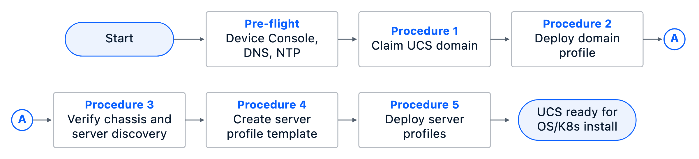
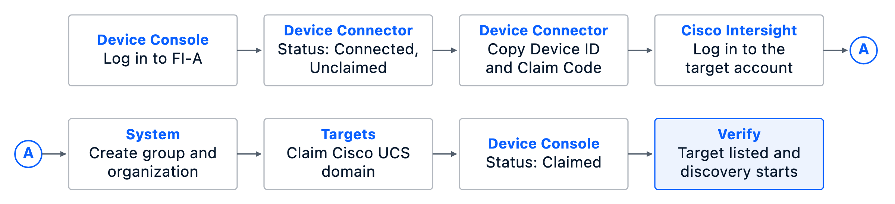

# Deploy Cisco UCS Management Nodes

The procedures in this chapter deploy a Cisco UCS X-Series Direct system for management. The system hosts the OpenShift control plane and can host additional infrastructure management services or other workloads as required.

The procedures will:

- Claim the UCS X-Series Direct system in Cisco Intersight as a Cisco UCS Domain (Intersight-Managed) target.
- Configure the domain profile, including VLAN, port, NTP, and Network Connectivity policies.
- Create the server profile template for the OpenShift management nodes.
- Derive server profiles from that template, including firmware, BIOS, and boot configuration.

Scope is hardware-level only. The OpenShift install and node role assignment are covered in the OpenShift cluster chapter.

<!-- Author note: Procedure 1 is drafted. Procedures 2–5 and the final node-readiness verification are in development. -->

## Assumptions and Prerequisites

Before implementing the procedures in this chapter, verify that the following prerequisites are met:

- Both Fabric Interconnect management IP addresses are configured and reachable over HTTPS.
- Valid administrator credentials for the Device Console.
- Fabric Interconnect initial setup is complete in Intersight Managed Mode. There is no Cisco UCS Manager on this pair.
- DNS and NTP services are the same services used by Nexus Dashboard. DNS used by the Device Connector must resolve `svc.intersight.com`. The Device Connector path must reach `svc.intersight.com` on TCP 443.
- Cisco Intersight account and licenses. If Cisco Cloud Control integration is used, configure the Intersight tenant in Cisco Cloud Control and ensure the claiming user has the required permissions.
- Claim the Fabric Interconnect pair once as the domain. Do not claim individual blades separately.

## Setup Information

Use the setup information in this section to complete the procedures outlined below. The procedures in this chapter are for manual deployment and use only the **Value** column.

::: {custom-style="Note"}
The Variable and Value columns match the key-value pairs used by automation. Ignore the Variable column for manual deployment.
:::

### Credentials

**Table 1. Credentials**

::: {colwidths="24,28,16,32"}

| Description | Variable | Value | Notes |
| --- | --- | --- | --- |
| Device Console username | `ucs.cimc.user` | `admin` | Same user on Fabric Interconnect A and B. |
| Device Console password | `vault_ucsx_mgmt_1_a_cimc_password`, `vault_ucsx_mgmt_1_b_cimc_password` | `<user_input>` | One key per Fabric Interconnect. |

:::

### Domain parameters

**Table 2. Domain setup parameters**

::: {colwidths="21,23,20,36"}

| Description | Variable | Value | Notes |
| --- | --- | --- | --- |
| UCS object | `ucs` | NA | Required for automation; ignore for manual. Parent structure for the relative variable keys below. |
| Platform | `.platform` | `domain` | Required for automation; ignore for manual. UCS X-Series Direct is claimed as a domain. |
| Claim target | `.claim_target` | `ucsx-mgmt-1` | Required for automation; ignore for manual. One name for the Fabric Interconnect pair. |
| Role | `.role` | `management` | Required for automation; ignore for manual. |
| DNS servers |  | `192.0.2.53`, `192.0.2.54` | Same as Nexus Dashboard. |
| NTP servers |  | `198.51.100.124`, `198.51.100.125` | Same as Nexus Dashboard. Specify which one is preferred when using multiple NTP servers. |
| Proxy |  | Skip | Match the Nexus Dashboard proxy choice. |

:::

### Per-Fabric Interconnect parameters

**Table 3. Per-Fabric Interconnect setup parameters**

::: {colwidths="16,19,20,20,25"}

| Description | Variable | FI-A | FI-B | Notes |
| --- | --- | --- | --- | --- |
| Hostname |  | `UCSX-MGMT-1-A` | `UCSX-MGMT-1-B` | Device Console hostname. |
| Management IP | `ucs.cimc.ip` | `198.18.0.10` | `198.18.0.11` | HTTPS Device Console. |

:::

### Intersight

**Table 4. Intersight setup parameters**

::: {colwidths="21,23,20,36"}

| Description | Variable | Value | Notes |
| --- | --- | --- | --- |
| Intersight URL | `intersight_api_uri` | `https://intersight.com` | |
| Intersight account | `intersight_account_name` | `ExampleAccount` | Same tenant as Nexus Dashboard. |
| Resource group | `intersight_resource_group_name` | `Example_RG` | Create if it does not exist. Select this group when claiming. |
| Organization | `intersight_organization_name` | `Example_ORG` | Create if it does not exist. Attach the resource group. |

:::

## Deployment Workflow

The high-level workflow below shows the end-to-end deployment path for the Cisco UCS X-Series Direct management system and OpenShift management nodes.

**Figure 1. UCS Management Node Deployment Workflow**

{width=6in}

**Procedure 1 — Details.** Claim the Fabric Interconnect pair once as one Cisco UCS domain.

**Figure 2. Procedure 1 — Claim the UCS Domain**

{width=6in}

Claim from Fabric Interconnect A. Fabric Interconnect B is a member of the same domain and is not claimed as a second target.

## Deployment Steps

Complete the procedures below using the Setup Information provided earlier in this section.

### Procedure 1. Claim the UCS X-Series Direct domain in Cisco Intersight

Use the procedure below to claim the management UCS X-Series Direct Fabric Interconnect pair in Cisco Intersight.

::: {custom-style="Note"}
The Cisco Cloud Control banner in the Intersight screenshots is an indication that this Intersight tenant is now linked and manageable from Cisco Cloud Control as well.
:::

1. Confirm DNS and NTP on both Fabric Interconnects match Table 2.
2. From a supported browser, open `https://<FI-A-management-IP>` and log in to the Device Console. Use HTTPS.
3. Open the **Device Connector** tab.
4. Confirm the connector can reach Cisco Intersight and that the status is **Not Claimed**.
5. Copy the **Device ID** and **Claim Code**.
6. Log into the Cisco Intersight tenant account from Table 4.
7. (Optional) To create a new resource group, navigate to **System > Resource Groups**. Click **Create Resource Group**. Specify the resource group name. Under **Resources**, click **Custom**. Click **Create**.
8. (Optional) To create a new organization, navigate to **System > Organizations**. Click **Create Organization**. Specify the organization name. Attach the resource group. Click **Create**.
9. Navigate to **System > Targets**.
10. Click **Claim a New Target**.
11. Choose **Cisco UCS Domain (Intersight-Managed)** and click **Start**.
12. Paste the **Device ID** and **Claim Code** copied from the Device Console. Select the resource group from Table 4. Click **Claim**.
13. Return to the Device Console **Device Connector** tab and click **Refresh**. Confirm the status is **Claimed**.
14. In Intersight, open **System > Targets** and confirm the domain appears. Chassis discovery starts after a successful claim.

## Validation Summary

- Device Console **Device Connector** on Fabric Interconnect A reports **Claimed**.
- Intersight **System > Targets** lists the domain in account `ExampleAccount` and resource group `Example_RG`.
- Chassis inventory is present for the claimed domain.
